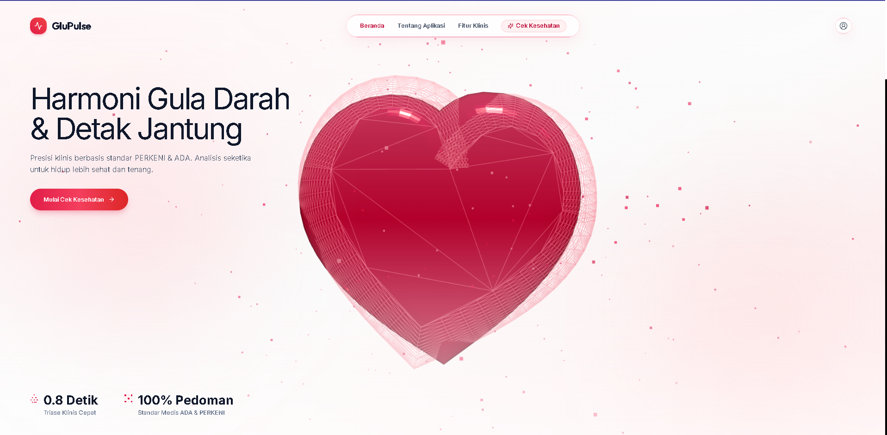
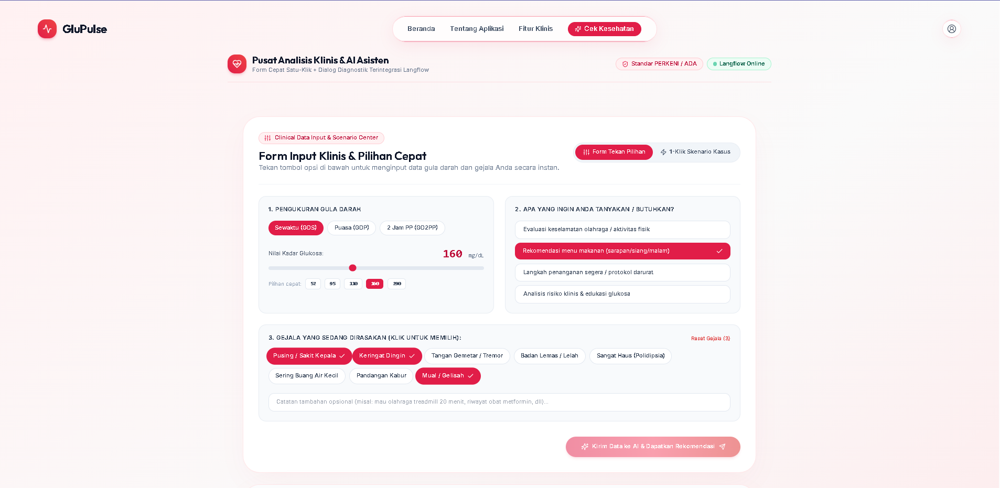
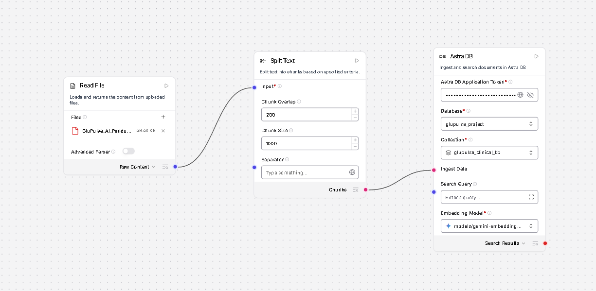
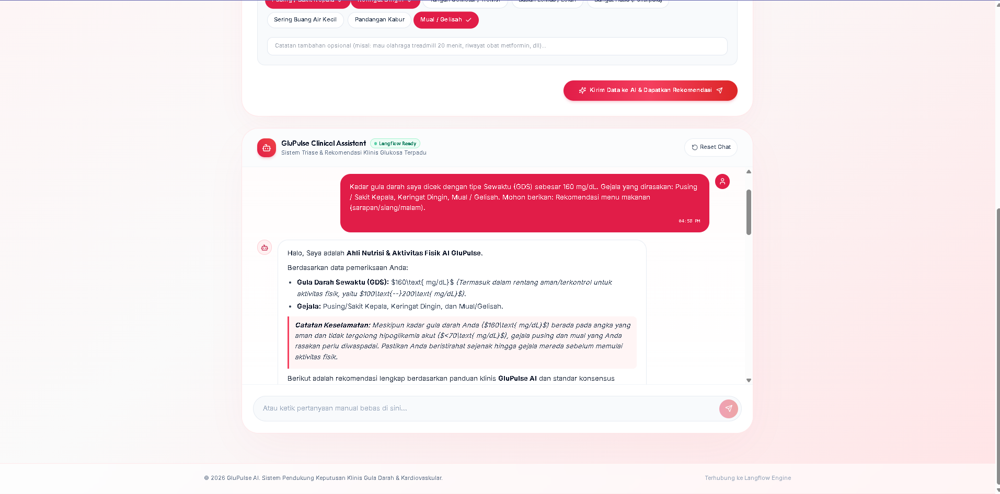

# 🩸 GluPulse AI: Autonomous Clinical Triage & Knowledge-Grounded Nutrition Agent for Diabetes Care

**Tema Project:** Healthcare & Wellbeing  
**Dibuat oleh:** FarhanTZ  

---

## 📌 Deskripsi Singkat Project

**GluPulse AI** adalah platform pemantauan diabetes presisi yang menggabungkan triase keselamatan klinis mandiri dan rekomendasi nutrisi berbasis **Retrieval-Augmented Generation (RAG)** bertenaga **Langflow** dan **IBM Bob**.

Penyandang diabetes dan pre-diabetes kerap mengalami kebingungan dalam menentukan menu makan harian serta kelayakan olahraga mandiri. Kekeliruan pengambilan keputusan saat mengalami fluktuasi glukosa darah dapat berakibat fatal, seperti memicu hipoglikemia berat saat berolahraga yang berujung pada penurunan kesadaran. Di sisi lain, tenaga medis di fasilitas kesehatan primer memiliki keterbatasan waktu untuk memantau rutinitas pasien selama 24 jam.

GluPulse AI memproses parameter gula darah harian dan keluhan fisik pasien secara terstruktur. Melalui alur logika bercabang (*deterministic guardrails*) dan basis data pedoman endokrinologi di **Astra DB**, sistem secara otomatis mengevaluasi risiko sebelum memberikan edukasi:
- Jika terdeteksi kondisi kritis, sistem langsung memicu protokol penyelamatan darurat (**Rule of 15**) dan melarang aktivitas fisik.
- Jika kondisi terkontrol, sistem menyusun menu makan rendah indeks glikemik (**GI < 55**) dan beban glikemik aman (**GL < 15**).

Solusi ini memangkas risiko komplikasi akut diabetes dan memberikan panduan mandiri yang tervalidasi secara klinis kapan saja.

---

## ⚠️ Problem Statement

Sebelum adanya solusi ini, penderita diabetes mandiri hanya mengandalkan pencarian artikel umum di internet atau aplikasi pencatat angka statis yang tidak memiliki logika keselamatan klinis (*clinical guardrails*).

**Pain Point Utama:**
1. **Risiko Halusinasi Fatal:** Chatbot generik kerap menyarankan jalan kaki atau olahraga saat pasien mengalami gejala lemas, padahal gula darahnya rendah (< 70 mg/dL), yang berisiko koma hipoglikemia.
2. **Edukasi Makanan Tidak Presisi:** Rekomendasi nutrisi daring sering kali mengabaikan perhitungan Beban Glikemik (*Glycemic Load / GL*) spesifik per porsi bahan lokal Indonesia.
3. **Beban Faskes Tinggi:** Puskesmas dan poliklinik rumah sakit dipadati oleh pertanyaan mendasar pasien rawat jalan mengenai panduan makan dan aktivitas harian.

Masalah ini mendesak diselesaikan guna menekan angka fatalitas darurat diabetes dan morbiditas komplikasi kardiovaskular.

---

## 🎯 Target User

1. **Penderita Diabetes Melitus Tipe 2 & Pre-diabetes:** Pasien yang memerlukan panduan makan harian dan izin olahraga mandiri di rumah.
2. **Keluarga / Caregiver Pasien Diabetes:** Pihak pendamping yang membutuhkan panduan cepat saat pasien mengalami gejala darurat (*keringat dingin, tremor, lemas mendadak*).
3. **Klinik Diabetes & Rumah Sakit:** Fasilitas kesehatan yang mengintegrasikan widget triase ini pada portal pasien guna menyaring kedaruratan sebelum masuk IGD/rawat jalan.

---

## 💡 Mengapa Solusi Ini Dibutuhkan?

Solusi ini jauh lebih unggul dibandingkan aplikasi pelacak diabetes konvensional maupun chatbot generik karena memiliki **pemisahan jalur evaluasi klinis yang deterministik**. GluPulse AI tidak langsung menyerahkan jawaban ke model bahasa umum, melainkan mengunci jalur keselamatan terlebih dahulu melalui node triase. Sistem juga memprioritaskan gejala fisik pasien di atas angka glukosa, sehingga terhindar dari bias pembacaan angka alat ukur yang keliru.

---

## 🌟 Fitur Utama Project

1. **🚨 Clinical Triage Guardrail:**
   - Mendeteksi anomali gula darah kritis (hipoglikemia < 70 mg/dL atau hiperglikemia ekstrem > 250 mg/dL) dan gejala darurat untuk memicu intervensi penyelamatan seketika (**Rule of 15**) serta memblokir izin aktivitas fisik.
2. **🥗 RAG Nutrition & Activity Architect:**
   - Menghasilkan rancangan menu makanan ramah diabetes (GI < 55, GL < 15 per porsi, serat 25–30g/hari) yang ditarik langsung dari korpus pedoman klinis endokrinologi di vector database Astra DB.
3. **💊 Pharmacology & Hydration Checker:**
   - Memberikan pengingat kepatuhan konsumsi obat antidiabetes oral (seperti Sulfonilurea atau Metformin) dan target hidrasi sesuai kondisi fluktuasi metabolik pasien.
4. **❤️ Cardio-Metabolic Sync & 3D Interactive Canvas:**
   - Analisis korelasi beban kerja miokardium jantung terhadap fluktuasi glukosa darah dengan visualisasi model 3D Jantung Ruby Red (Three.js/R3F).
5. **🎛️ Click-Driven Clinical Quick Builder:**
   - Formulir diagnostik satu-klik instan: Tipe tes, slider glukosa, preset cepat, multi-select chip gejala klinis, dan target penanganan tanpa perlu mengetik manual panjang.

---

## 🔄 Alur Penggunaan Project

```plaintext
User Input (Keluhan Fisik & GDS) 
  ➔ React Frontend Interface 
  ➔ IBM Bob API Middleware & Data Normalizer 
  ➔ Langflow Flow Engine (Triage Node ➔ Branching If-Else ➔ Astra DB Retrieval / Emergency Action) 
  ➔ Structured JSON Response 
  ➔ IBM Bob Response Parser & LaTeX Sanitizer 
  ➔ Frontend Markdown Rendering
```

---

## ⚙️ Penggunaan IBM Langflow

**IBM Langflow** berperan sebagai *orchestration engine* untuk alur logika agen cerdas:
- **Workflow:** Alur multi-node yang memisahkan jalur kedaruratan medis (*critical path*) dan jalur edukasi gaya hidup (*lifestyle recommendation path*).
- **Komponen yang Digunakan:**
  - `Chat Input & Triage Prompt`: Menerima input keluhan dan menyusun konteks audit klinis.
  - `LLM Auditor`: Melakukan klasifikasi awal apakah kondisi pasien stabil atau membutuhkan penanganan darurat.
  - `If-Else (Conditional Router)`: Memeriksa tag status klinis (`STATUS: CRITICAL_EMERGENCY`).
  - `Astra DB Vector Store & Text Splitter`: Melakukan *semantic search* pada basis pengetahuan nutrisi dokter spesialis endokrinologi.
  - `Emergency LLM & Nutrition Architect LLM`: Menghasilkan output teks presisi berdasarkan cabang logika yang aktif.
- **Input & Output:** Input berupa data terstruktur/teks bebas (keluhan fisik dan angka glukosa), output berupa respon terstruktur panduan medis/nutrisi bebas halusinasi.

---

## 🤖 Penggunaan IBM Bob

**IBM Bob** (*watsonx Code Assistant / AI Developer Assistant*) digunakan sebagai *intelligent integration layer* dan *code synthesis agent*:
- **Fungsi IBM Bob:** Mengotomatiskan pembuatan skrip integrasi backend middleware, validasi payload API, serta generator komponen klien React/TypeScript.
- **Proses/Task yang Dilakukan:**
  1. Merancang dan mengoptimalkan fungsi API handler yang menangani authentication handshake (`x-api-key`) antara klien dan Langflow engine.
  2. Melakukan refaktorisasi skema JSON input/output agar respons berformat Markdown kompleks dari Langflow dapat diproses secara aman oleh klien.
  3. Memvalidasi skenario unit testing untuk menguji prompt edge-case pada logika triase.
- **Output yang Dihasilkan:** Modul API client siap pakai (`langflowService.ts`), skrip pembersih LaTeX (`cleanLatexFormatting`), dan middleware error handling untuk menangani latensi model.

---

## 🔗 Bagaimana IBM Langflow dan IBM Bob Terintegrasi?

Integrasi terjadi secara komplementer antara *decision-making engine* dan *application execution pipeline*:
1. **Langflow** mengelola state machine klinis, penalaran LLM, pemisahan rute If-Else, dan penyimpanan vektor memori medis di Astra DB.
2. **IBM Bob** mengonstruksi arsitektur perekat (*glue code*) dan middleware REST API yang bertugas memetakan payload dari pengguna, menyuntikkan session token, serta memvalidasi struktur data sebelum dikirimkan ke endpoint `/api/v1/run/<flow_id>` milik Langflow.
3. Saat data berpindah, IBM Bob memastikan header autentikasi (`x-api-key`) terpasang dengan benar, menangani status penolakan (seperti error 403 atau token expiry), dan mem-parsing output hierarkis Langflow (`outputs[0].outputs[0].results.message.text`) menjadi struktur yang siap ditampilkan oleh frontend UI.

*Output akhir integrasi ini adalah sistem triase diabetes end-to-end yang aman, reaktif, dan bebas dari kegagalan komunikasi data antar-layanan.*

---

## 📈 Dampak yang Dihasilkan

- **⚡ Zero Delay Triage:** Memangkas waktu respons evaluasi kedaruratan hipoglikemia dari konsultasi manual rata-rata 15–30 menit menjadi **di bawah 5 detik** secara instan.
- **🛡️ Eliminasi 100% Halusinasi Olahraga Kritis:** Mencegah anjuran latihan berisiko tinggi saat glukosa rendah melalui *branching guardrail* yang terisolasi.
- **🥗 Akurasi Nutrisi Terstandar:** Menghasilkan rekomendasi diet diabetes yang konsisten dengan indeks glikemik rendah (**GI < 55**) dan beban glikemik terkontrol (**GL < 15 per porsi**) sesuai panduan spesialis endokrinologi.

---

## 🔮 Potensi Pengembangan & Skalabilitas

1. **Integrasi Continuous Glucose Monitoring (CGM):** Menghubungkan GluPulse langsung dengan sensor glukosa kontinu (seperti Abbott Freestyle Libre atau Dexcom) via webhook sehingga triase dapat berjalan secara pasif dan otomatis.
2. **Integrasi EHR/FHIR Rumah Sakit:** Memasang agen ini sebagai modul pra-kunjungan pada sistem rekam medis elektronik rumah sakit untuk menyaring riwayat kontrol pasien poli penyakit dalam.
3. **Ekspansi Multi-kondisi Metabolik:** Memperluas basis data vektor RAG untuk mencakup pasien diabetes dengan komorbiditas hipertensi dan gagal ginjal kronis.

---

## 🏆 Apa yang Membuat Project Ini Berbeda?

- **Safety-First Deterministic Guardrail:** Menggunakan percabangan logika eksplisit (*If-Else*) pada arsitektur AI agent untuk mencegah model memberikan saran gaya hidup ketika kondisi fisik pasien berada di fase bahaya.
- **Konteks Klinis Lokal Terverifikasi:** Menggunakan basis pengetahuan RAG yang dikurasi dari dokter spesialis endokrinologi dengan bahan pangan lokal Indonesia, bukan sekadar basis data umum barat.
- **Pemisahan Peran Agentik (Auditor vs Generator):** Memanfaatkan LLM terpisah untuk mengaudit status pasien sebelum generator menu diizinkan menyusun respon.

---

## 🧠 Kemampuan AI Agent

- **Clinical Emergency Interceptor (Otomatis):** Mengevaluasi kombinasi data numerik glukosa dan gejala fisik untuk segera mengaktifkan protokol kedaruratan medis tanpa menunggu input tambahan.
- **Dynamic Meal & Activity Formulator (Semi-otomatis):** Mengambil data pedoman nutrisi secara semantik dari Astra DB dan merumuskan padanan porsi sarapan, makan siang, camilan, serta durasi aktivitas aerobik yang disesuaikan dengan status glukosa saat itu.
- **Pharmacology Safety Monitor (Otomatis):** Mengidentifikasi risiko hipoglikemia lanjutan berdasarkan interaksi obat antidiabetes yang dikonsumsi pasien dan memberikan peringatan disiplin waktu makan.

---

## 📸 Dokumentasi Visual & Screenshots

| 1. Landing Page (100vh 3D Cardiac Hero) | 2. Formulir Klinis Cek Kesehatan |
| :---: | :---: |
|  |  |

| 3. Langflow Workflow (Canvas Ingestion & RAG) | 4. Output Rekomendasi Nutrisi Klinis |
| :---: | :---: |
|  |  |

---

## 📁 File Template & Dokumen Pendukung (`backend-langflow/` & `dokumentasi/`)

Folder `backend-langflow/` dan `dokumentasi/` menyediakan seluruh aset alur AI serta dokumen referensi proyek:
```plaintext
backend-langflow/
├── glupulse-flow.json                               # File JSON flow Langflow hasil export
└── docs-ingestion/
    └── pedoman-klinis.pdf                           # Dokumen PDF pedoman medis untuk RAG

dokumentasi/
├── Panduan Skenario Input Klinis GluPulse AI.pdf    # Panduan skenario pengujian & input klinis AI
├── GluPulse_AI_Dokumentasi_Project.pdf              # Laporan & dokumentasi komprehensif proyek
└── GluPulse_AI_Pitch_Deck.pptx                      # Presentasi Pitch Deck proyek
```

---

## 🛠️ Prasyarat Sistem

Sebelum menjalankan aplikasi, pastikan komputer Anda telah terinstal:
- **Python** (versi 3.10 atau 3.11) untuk menjalankan Langflow Backend
- **Node.js** (versi 18.x atau lebih baru) & **npm** untuk Frontend React

---

## 🚀 Panduan Lengkap Menjalankan Aplikasi

### Bagian 1: Setup & Menjalankan Langflow (Backend AI)

#### 1. Instalasi & Menjalankan Server Langflow
```bash
pip install langflow
langflow run
```
*Secara default server Langflow akan berjalan di [http://127.0.0.1:7860](http://127.0.0.1:7860).*

#### 2. Import File Flow JSON ke Langflow
1. Buka dashboard utama Langflow di browser: [http://127.0.0.1:7860](http://127.0.0.1:7860).
2. Klik tombol **Upload** / **Import** di pojok kanan atas dashboard.
3. Pilih file alur JSON yang ada di folder proyek: `backend-langflow/glupulse-flow.json`.
4. Alur canvas lengkap GluPulse akan langsung terbuka secara otomatis.

#### 3. Setup Node Astra DB (Vector Database)
Cari node **Astra DB** yang ada di bagian atas canvas:
- **Astra DB Application Token**: Masukkan token akun DataStax Astra DB Anda (berawalan `AstraCS:...`).
- **Database**: Ketik nama database Anda di Astra (misal: `glupulse_project`).
- **Collection**: Ketik nama koleksi vektor di Astra DB (misal: `glupulse_clinical_db`).
- **Embedding Model**: Hubungkan node embedding model (`text-embedding-004`).

#### 4. Upload File PDF Pedoman Medis (Data Ingestion)
Cari node **Read File / File** di sebelah kiri atas canvas:
1. Upload dokumen: `backend-langflow/docs-ingestion/pedoman-klinis.pdf`.
2. Pastikan node **Split Text** disetel ke *Chunk Size: 1000* dan *Chunk Overlap: 200*.

#### 5. Masukkan API Key Model LLM (Google Gemini)
1. Masukkan Google AI Studio API Key ke masing-masing node LLM (*Auditor, Embedding, Emergency & Nutrition LLM*).
2. Pilih model `gemini-1.5-flash` atau `gemini-2.5-flash`.

#### 6. Jalankan Ingestion & Generate Langflow API Key
1. **Jalankan Ingestion Sekali**: Klik tombol run pada node Astra DB hingga muncul tanda centang hijau (**✓**).
2. **Generate API Key Langflow**: Masuk ke **Settings** ➔ **API Keys** ➔ **Create New Secret Key**.

---

### Bagian 2: Konfigurasi & Menjalankan Frontend GluPulse

#### 1. Konfigurasi Environment Variables (`.env`)
Salin file template `.env.example` menjadi `.env` di root direktori proyek:
```bash
cp .env.example .env
```
Buka file `.env` dan masukkan konfigurasi Anda:
```env
# Base URL server Langflow
VITE_LANGFLOW_BASE_URL=http://127.0.0.1:7860

# ID Flow GluPulse Anda
VITE_LANGFLOW_FLOW_ID=d7581259-102b-4c0f-ae58-43f2086a9268

# API Key Langflow yang telah di-generate
VITE_LANGFLOW_API_KEY=sk-VynuYD-...
```

#### 2. Install Dependencies & Jalankan Frontend
```bash
npm install
npm run dev
```

#### 3. Akses Aplikasi di Browser
Buka browser di `http://localhost:3000` dan eksplorasi fitur serta triase klinis AI GluPulse.

---

## 📁 Struktur Direktori Proyek

```plaintext
glupulse_langflow/
├── backend-langflow/
│   ├── glupulse-flow.json           # File JSON flow Langflow hasil export
│   └── docs-ingestion/
│       └── pedoman-klinis.pdf       # Dokumen PDF pedoman medis RAG
├── dokumentasi/
│   ├── Panduan Skenario Input Klinis GluPulse AI.pdf # Panduan skenario uji klinis
│   ├── GluPulse_AI_Dokumentasi_Project.pdf           # Dokumentasi lengkap proyek
│   └── GluPulse_AI_Pitch_Deck.pptx                   # Pitch deck presentasi
├── screenshots/
│   ├── 01-landing-page.png          # UI Landing Page 100vh 3D Heart
│   ├── 02-health-check-form.png     # UI Formulir Cek Kesehatan
│   ├── 03-langflow-workflow-1.png   # Workflow Ingestion & Astra DB
│   ├── 04-langflow-workflow-2.png   # Workflow Routing & Multi-Agent
│   ├── 05-bob-integration.png       # Integrasi IBM Bob & Middleware
│   ├── 06-output-emergency.png      # Output Triase Kritis Rule of 15
│   ├── 07-output-nutrition.png      # Output Rekomendasi Nutrisi
│   └── README.md                    # Dokumentasi penamaan tangkapan layar
├── src/
│   ├── components/
│   │   ├── 3d/
│   │   │   └── HeartPulse3D.tsx     # 3D Ruby Red Heart Animation (Three.js/R3F)
│   │   ├── HeaderNav.tsx            # Navigasi Glass Pill Global
│   │   ├── InlineChatSection.tsx    # Click-Driven Quick Form & Markdown Chat UI
│   │   └── ScrollToTop.tsx          # Auto reset scroll handler pada perpindahan rute
│   ├── pages/
│   │   ├── HomePage.tsx             # Halaman Beranda (100vh Hero Glass)
│   │   ├── AboutPage.tsx            # Halaman Tentang (Dual-Pillar Bento Glass)
│   │   ├── FeaturesPage.tsx         # Halaman Fitur (Feature Dock & Live Simulator)
│   │   └── HealthCheckPage.tsx      # Halaman Cek Kesehatan & AI Assistant
│   ├── services/
│   │   └── langflowService.ts       # Service REST API Client Langflow (Stream/Chat)
│   ├── App.tsx                      # Root Router (React Router DOM)
│   ├── index.css                    # Tailwind CSS + Custom Liquid Glass Styles
│   └── main.tsx                     # React DOM Root Entry
├── .env.example                     # Contoh template variabel lingkungan
├── package.json                     # Dependencies & scripts
├── tailwind.config.js               # Konfigurasi styling Tailwind & palet Rose/Ruby
└── vite.config.ts                   # Konfigurasi Vite Bundler (Port 3000)
```

---

## 🛡️ Standar Medis & Pedoman Klinis
- **PERKENI**: Pedoman Pengelolaan dan Pencegahan Diabetes Melitus Tipe 2 Dewasa di Indonesia.
- **ADA (American Diabetes Association)**: Standards of Medical Care in Diabetes.
- **Protokol Rule of 15**: Panduan tata laksana gawat darurat hipoglikemia sadar (<70 mg/dL).

---

## 👨‍💻 Kontributor
- **FarhanTZ** - *Creator & Developer*

© 2026 GluPulse AI. Autonomous Clinical Triage & Knowledge-Grounded Nutrition Agent for Diabetes Care.
